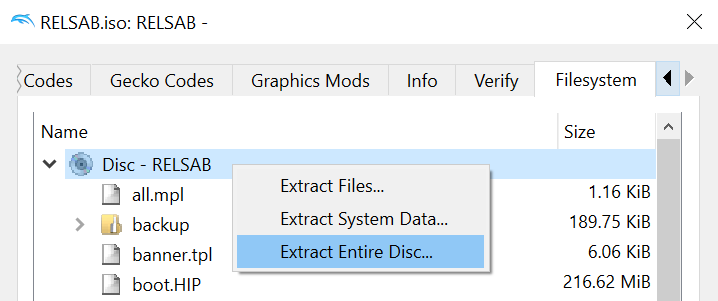
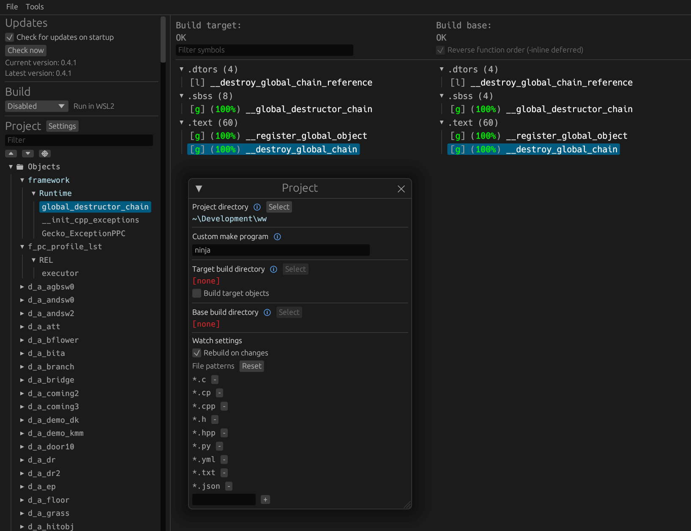

EvilEngine  
[![Build Status]][actions]
==========

[Build Status]: https://github.com/seilc/evilengine/actions/workflows/build.yml/badge.svg
[actions]: https://github.com/seilc/evilengine/actions/workflows/build.yml

A shared decompilation of Heavy Iron's EvilEngine: one source tree that builds several of its games, each version
matching its original executable byte for byte. It started as a copy of the [Ratatouille (Jan 18, 2006
prototype)](https://github.com/seilc/rat) decompilation; the other games' units are merged into Rat's files one by
one. The per-game decompilations stay the ground truth: changes are ported here from them.

This repository does **not** contain any game assets or assembly whatsoever. Existing copies of the games are
required.

Full disclosure: code matched before October 21, 2026 was decompiled by hand. Since then, the project has been
AI-assisted: new code is decompiled with the help of an LLM, then reviewed and checked against the original binaries.
Matching code is byte-identical to the original, but names, types and source structure beyond what the binaries
and their debug info prove may be guesses.

Supported versions:

- `RAT_DEBUG` - Ratatouille (Jan 18, 2006 prototype), ratsgc_d.elf
- `RAT_RELEASE` - ratsgc_r.elf
- `RAT_MASTERDEBUG` - ratsgc_md.elf
- `RAT_MASTER` - ratsgc_m.elf
- `ROTU` - The Incredibles: Rise of the Underminer (GC, USA), GIQE78

Layout
======

- `src/Engine/Core/x`, `src/Engine/Core/gc` - the engine's platform-independent and GameCube code, shared by every
  game.
- `src/Engine/Game` - game code two or more games share.
- `src/Engine/Game/<root>` - one game's own files, named after Heavy Iron's source root for that game (`rt`
  Ratatouille, `in2` Rise of the Underminer, `in` The Incredibles, `sb04` The SpongeBob SquarePants Movie, `SB` Battle
  for Bikini Bottom, `SD2` Scooby-Doo! Night of 100 Frights). Each version's include path has its game's folder before
  `src/Engine/Game`.
- `src/<sdk>` - the SDKs and libraries (dolphin, rwsdk, PowerPC_EABI_Support, bink, fmod, revolution).
- `include/game.h` - the games in release order (`N100F` < `BFBB` < `TSSM` < `INCREDIBLES` < `ROTU` < `RAT`);
  configure.py defines `GAME` per version. A difference between games is a gate, only where a game's binary
  proves one:

  ```cpp
  #if GAME >= RAT
  void xRayHitsSceneFlags(xScene* sc, const xRay3* r, xCollis* coll, U8 collType, U8 chk);
  #else
  void xRayHitsSceneFlags(xScene* sc, xRay3* r, xCollis* coll, U8 collType, U8 chk);
  #endif
  ```

- `config/<version>/` - each version's dtk config. A version links every object from its split until its first unit
  is merged.

Dependencies
============

Windows
--------

On Windows, it's **highly recommended** to use native tooling. WSL or msys2 are **not** required.  
When running under WSL, [objdiff](#diffing) is unable to get filesystem notifications for automatic rebuilds.

- Install [Python](https://www.python.org/downloads/) and add it to `%PATH%`.
  - Also available from the [Windows Store](https://apps.microsoft.com/store/detail/python-311/9NRWMJP3717K).
- Download [ninja](https://github.com/ninja-build/ninja/releases) and add it to `%PATH%`.
  - Quick install via pip: `pip install ninja`

macOS
------

- Install [ninja](https://github.com/ninja-build/ninja/wiki/Pre-built-Ninja-packages):

  ```sh
  brew install ninja
  ```

- Install [wine-crossover](https://github.com/Gcenx/homebrew-wine):

  ```sh
  brew install --cask --no-quarantine gcenx/wine/wine-crossover
  ```

After OS upgrades, if macOS complains about `Wine Crossover.app` being unverified, you can unquarantine it using:

```sh
sudo xattr -rd com.apple.quarantine '/Applications/Wine Crossover.app'
```

Linux
------

- Install [ninja](https://github.com/ninja-build/ninja/wiki/Pre-built-Ninja-packages).
- For non-x86(_64) platforms: Install wine from your package manager.
  - For x86(_64), [wibo](https://github.com/decompals/wibo), a minimal 32-bit Windows binary wrapper, will be automatically downloaded and used.

Building
========

- Clone the repository:

  ```sh
  git clone https://github.com/seilc/evilengine.git
  ```

- Using [Dolphin Emulator](https://dolphin-emu.org/), extract your game to `orig/RELSAB`.

  - To save space, the only necessary files are the following. Any others can be deleted.
    - `files/ratsgc_d.elf`
    - `files/ratsgc_m.elf`
    - `files/ratsgc_md.elf`
    - `files/ratsgc_r.elf`
- For `ROTU`, extract Rise of the Underminer's `sys/main.dol` to `orig/GIQE78/sys/main.dol`.
- Configure:

  ```sh
  python configure.py -v VERSION
  ```
  Replace `VERSION` with `RAT_DEBUG`, `RAT_RELEASE`, `RAT_MASTERDEBUG`, `RAT_MASTER`, or `ROTU`.

- Build:

  ```sh
  ninja
  ```

Code style
==========

The game code is formatted by hand, not by clang-format, and some of it looks inconsistent on purpose. The DEBUG
build's debug info records which source line each piece of code came from, so the layout follows it where it can: a loop or
`if` written on one line without braces, several statements on one line, or brace style changing within a file
usually reflect which statements shared a line in the original source. Assert conditions are spelled exactly as
in the original binary's assert strings (`0==xSTFindAsset(...)`), since the compiler stringifies them.

Please don't run an auto-formatter over the C/C++ source. New code follows the surrounding code: 4-space indent,
function braces on their own line, control-statement braces on the same line.

Diffing
=======

Once the initial build succeeds, an `objdiff.json` should exist in the project root.

Download the latest release from [encounter/objdiff](https://github.com/encounter/objdiff). Under project settings, set `Project directory`. The configuration should be loaded automatically.

Select an object from the left sidebar to begin diffing. Changes to the project will rebuild automatically: changes to source files, headers, `configure.py`, `splits.txt` or `symbols.txt`.


